<!-- Profile README for github.com/zydusX3
     Before committing: replace every EDIT_ placeholder (search for "EDIT").
     The banner lives in assets/banner.svg — commit that folder too. -->

  

  
  
  
  <!--
-->

### 👋 About me

Senior Embedded Software Engineer with **4+ years** shipping firmware on RTOS and Embedded Linux, and the
hardware–software glue in between. A self-confessed jack of all trades: I go from schematics and drivers up
to robots that move and models that run on the edge. I also teach and mentor, because explaining something
is the best test of whether you really understand it.

- 🔭 **Now building:** a long-life, weatherproof tracker for cattle roaming the hills
- 🌱 **Levelling up:** ROS 2, Zephyr RTOS, TinyML on microcontrollers
- 🤝 **Open to:** freelance firmware/IoT work · full-time embedded & robotics roles · workshops and talks
- ⚡ **Fun fact:** I'll happily debug a board with a logic analyser at 2 a.m.

### 🧭 What I work on

<table>
  <tr>
    <td width="33%" valign="top">
      <b>🔌 Embedded</b> 
      Bare-metal & RTOS firmware, drivers, bootloaders, low-power design, Embedded Linux bring-up, UART · SPI · I²C · CAN
    </td>
    <td width="33%" valign="top">
      <b>🤖 Robotics</b> 
      Motor control, sensor fusion, ROS 2 nodes, micro-ROS on MCUs, real-time control loops
    </td>
    <td width="33%" valign="top">
      <b>🧠 Edge AI</b> 
      TinyML, quantised models on MCUs and SBCs, on-device vision and anomaly detection
    </td>
  </tr>
</table>

### 📌 Featured projects

<!-- Keep 4. Each card: one line on what it is, one line on the hard part, a badge or two. Pin the same repos. -->
<table>
  <tr>
    <td width="50%" valign="top">
      <a href="https://github.com/zydusX3/EDIT_REPO"><b>🐄 Cattle Tracker</b></a> 
      Custom-board GPS tracker for a free-roaming herd, built to run for months on a battery. <i>Hard part:</i> µA-level sleep budgets and staying reachable under forest canopy. 
        
    </td>
    <td width="50%" valign="top">
      <a href="https://github.com/zydusX3/EDIT_REPO"><b>⏱️ RTOS Sensor Hub</b></a> 
      Multi-sensor data logger on FreeRTOS/Zephyr with a driver layer and CI-tested firmware. <i>Hard part:</i> deterministic timing and clean HAL boundaries. 
       
    </td>
  </tr>
  <tr>
    <td width="50%" valign="top">
      <a href="https://github.com/zydusX3/EDIT_REPO"><b>🤖 Differential-Drive Robot</b></a> 
      ROS 2 robot with micro-ROS on the MCU, encoder odometry and SLAM. <i>Hard part:</i> real-time motor control talking to a Linux brain. 
       
    </td>
    <td width="50%" valign="top">
      <a href="https://github.com/zydusX3/EDIT_REPO"><b>🧠 TinyML Keyword Spotter</b></a> 
      Voice command model running fully on a Cortex-M4. <i>Hard part:</i> fitting the model into a few hundred KB of RAM. 
       
    </td>
  </tr>
</table>

### 🛠️ Toolbox

<!-- Keep only what you can talk about confidently in an interview. -->
**Languages** &nbsp;

 
**Embedded** &nbsp;

 
**Robotics & AI** &nbsp;

 
**Tooling** &nbsp;

### 📊 Activity

  
  

<b>🌿 Beyond the bench</b>

 
Curious about biology, space and how nature solves engineering problems. Off-screen I travel, explore the
outdoors and take photographs. I run workshops and college sessions on embedded systems through Vyomeki,
and I'm always up for a chat about a weird hardware bug.

⭐ If something here helped you, a star or an issue is always welcome.

